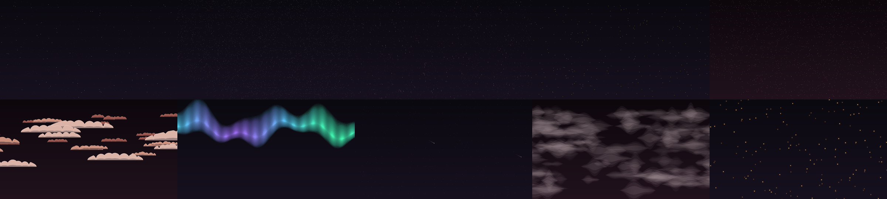
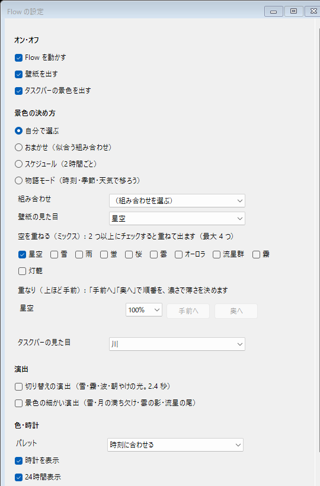
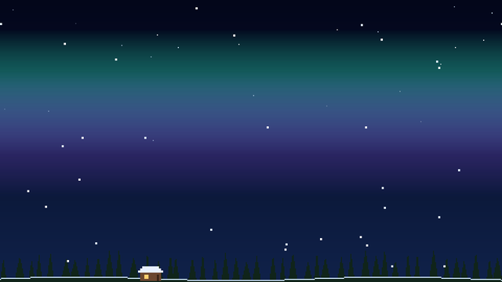
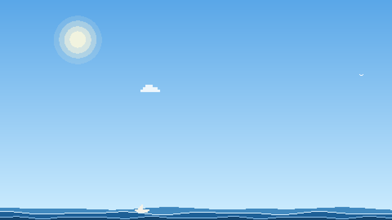

# Flow

**デスクトップの壁紙と、タスクバー（Mac は Dock）に、ドット絵風の景色を描くアプリです。**
星・雪・雨・蛍・桜・雲・オーロラ・流星群・霧・灯籠、川・砂・海・山・街・草原・雪原・森。1日を2時間ずつに分けて景色を切り替えたり、似合う組み合わせを「おまかせ」で入れ替えたりできます。
景色は、テキストファイル1つで**自分で足せます**（AI に作ってもらうこともできます）。

*Flow draws pixel-art scenery on your wallpaper and on the taskbar (Dock on Mac): stars, snow, rain, fireflies, sakura, clouds, aurora, meteors, fog, lanterns, rivers, sea, mountains, a city, a forest... A schedule changes the scene every two hours, "random" mixes matching pairs, and you can add your own scenes with a single text file. Free. Windows 10/11 and macOS 13+.*



## インストール

### Windows（PowerShell に貼って実行）

```powershell
irm https://raw.githubusercontent.com/kodair918-del/flow-releases/main/install.ps1 | iex
```

ダウンロード、チェックサムの確認、`%LOCALAPPDATA%\Flow` への配置、スタートメニューへの登録、起動まで自動です。

- 壁紙: Windows 10 (1809) 以降の 64 ビット
- タスクバーの景色: Windows 11（版を問わず試します。動かない版では、タスクバーには何も変えず、壁紙だけ動きます）

### Mac（ターミナルに貼って実行）

```bash
curl -fsSL https://raw.githubusercontent.com/kodair918-del/flow-mac-releases/main/install.sh | bash
```

macOS 13 以降。Apple の署名はないので、スクリプトが警告を外して起動します。

## 使い方

通知領域（Windows）／メニューバー（Mac）の波のアイコンから操作します。



- **オン・オフ**: アイコンをダブルクリック（Windows）／ `Ctrl+Alt+F`（Windows）・`⌃⌥⌘F`（Mac）。コマンドでも切り替えられます（`FlowTray.exe --off`、Mac は `Flow --toggle`）。
- **景色の決め方**: 自分で選ぶ／おまかせ（似合う組み合わせ）／スケジュール（24時間の円を2時間ずつ12に分けて、それぞれに景色を割り当て）
- 色（時刻に合わせる・深海・アンバー・ネオン・燠火）、時計、クリックの反応、起動時に開始、更新

景色が変わるときは、約1.6秒かけてなめらかに溶け合います。

## 景色を足す（追加パック）

`pack.json` というテキストファイルを `packs` フォルダーに置くだけで、新しい景色が増えます。プログラミングは要りません。


- **ギャラリー**: メニューの「追加パック → ギャラリーから入れる」で、できあがったパックを1クリックで入れられます。人から受け取った `pack.json` は「ファイルから読み込む…」で入ります。

| | | |
|---|---|---|
|  桜並木の朝 |  雪の夜の山小屋 |  蛍の草原 |
|  夕焼けと松林 |  夜の街 |  海風の朝 |

- 作り方: [docs/SCENE-PACK-GUIDE.md](docs/SCENE-PACK-GUIDE.md)
- **AI に作ってもらう**: [docs/PROMPT-FOR-AI.md](docs/PROMPT-FOR-AI.md) をそのまま AI に貼って、作りたい景色を書くだけ。検査ツール（`flowpack`）が間違いを日本語まじりで具体的に教えるので、AI に貼り戻せば直してくれます。
- メニューの「追加パック → サンプルパックを入れる」で、見本が3つ入ります。

## 更新

1日に1回、新しい版を探して自動で入れ替えます（メニューで切れます）。入れ替えの前に、チェックサムと中身を確かめます。

## 安全について（よくある質問）

**何をするアプリですか。**
壁紙の裏に絵を描く窓を置き、（Windows 11 では）タスクバーの背景に絵を差し込みます。Windows では、タスクバーを見つけるために、Explorer に小さな部品（`xamlh.dll`）を読み込ませます。Visual Studio などが使う「XAML Diagnostics」という公開の仕組みで、システムのファイルは書き換えません。

**ウイルス対策ソフトに警告されました。**
部品に署名がなく、「Explorer に差し込む」動きが警告の条件に似ているためです。心配な場合は使わないでください。チェックサム（SHA-256）は `latest.json` に載っており、インストーラーが毎回照合しています。

**データを集めますか。**
集めません。通信は、更新の確認（`raw.githubusercontent.com` の `flow-releases`／`flow-mac-releases`）だけです。メニューの「自動で更新する」を切ると、自分で押したときだけ通信します。

**やめたいとき。**
Windows はスタートメニューの「Flow - uninstall」、Mac はアプリを削除して `~/Library/Application Support/Flow` を消します。Windows では、アンインストールのときに Explorer が1回再起動します。

**うまく動かないとき。**
Windows は `%LOCALAPPDATA%\Flow` の `xamlh.log` と `flowtray.log`、`FlowWall.log` を見ると原因が分かります。

## ライセンス

[LICENSE.txt](LICENSE.txt) を見てください。無料で使って、そのまま配ってかまいません。保証はありません。自分で作った景色パックは、作った人のものです。
